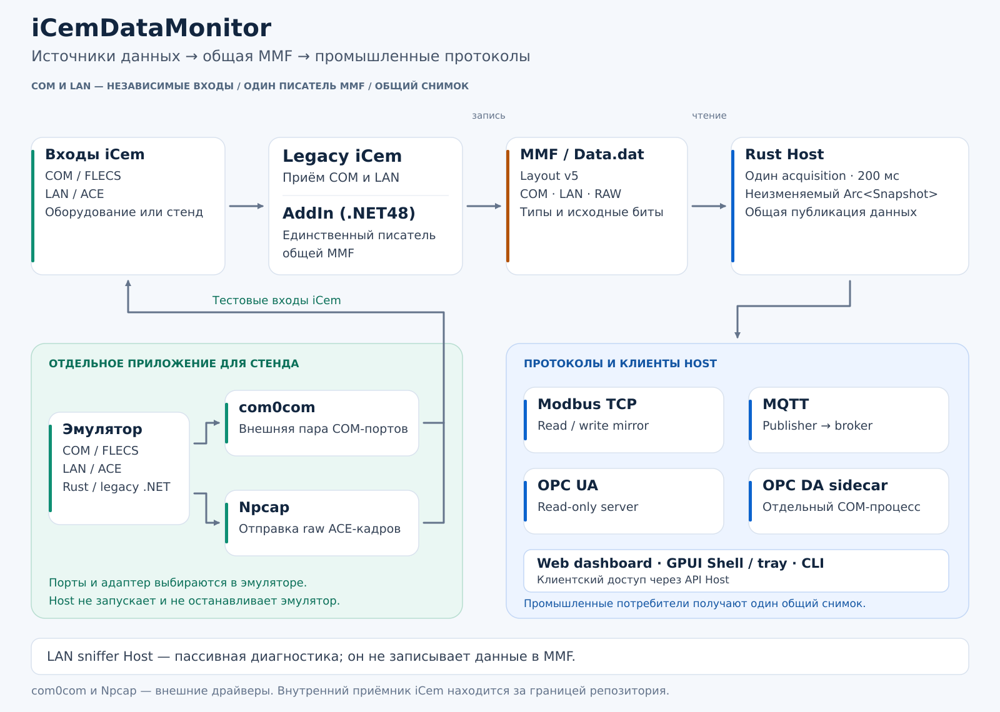

# iCem Data Monitor

Монитор станции iCem (Halliburton/Burservis): Rust Host и нативная GPUI Shell,
независимый Rust emulator, сохранённый net48 AddIn внутри vendor iCem.exe.
Согласованный программный объём и N+1 v1.7 реализованы; [трекер и evidence](src/rust/docs/NPLUS1_TRACKER.ru.md)
отделяют завершение software от production cutover, аппаратной, операторской,
визуальной и реальной SDK/MSI-приёмки. Имена исполняемых файлов пока содержат `-dev`.
Это не свидетельство прохождения перечисленных release gates.

## Как проходят данные



[Подробная архитектура и владение](docs/architecture.md).
Физические COM/LAN либо самостоятельный emulator (COM FLECS через внешнюю пару
com0com; LAN ACE через Npcap) подают данные в **iCem.exe**. AddIn переводит их в
MMF layout 5 / `Data.dat` и остаётся **единственным writer**. Host читает MMF
одним acquisition каждые 200 мс, затем разделяет типизированный `Arc<Snapshot>`
между Modbus, Web, MQTT, OPC UA и OPC DA sidecar. Частоты потребителей независимы.
Пассивный LAN sniffer Host обслуживает диагностику, decode/catalog и counters;
он не пишет MMF. Host не запускает и не завершает emulator.

Снятые dormant REST/admin wrappers и serial Tee/Com0ComMonitor не нужны
самостоятельному emulator. **Драйвер com0com сохранён**: он обеспечивает внешнюю
пару портов. [C11: точный объём retirement](docs/LEGACY_REFACTORING_C11.ru.md).
Legacy .NET assemblies остаются reference/build compatibility surface;
фактическая история базового дерева сохраняется в manifest/ledger.

## Что реализовано

- MMF v5: owned copy под native mutex, decode после unlock, один источник снимков.
- Modbus TCP FC03/04/06/16, отдельное writable зеркало и сохранённая политика зон.
- Сохранённая SPA, четыре активных REST GET, история, gRPC/gRPC-Web и local pipe.
- GPUI Shell и emulator UI; отдельные tray/lifecycle, managed logs, CLI.
- Независимый emulator: DFB, COM FLECS, LAN ACE/Npcap, каталоги, units/overrides,
  selftest, LAN diagnostic и stdin/control pipe.
- Необязательные MQTT, read-only OPC UA и OPC DA sidecar над общей публикацией.
- Windows MSI candidate: Rust приложения, обязательный оригинальный net48 AddIn,
  Burservis branding, repair/upgrade/uninstall и сохранение пользовательских данных.

Приёмочные ограничения и точные Windows checkpoints: [N+1](src/rust/docs/NPLUS1_TRACKER.ru.md),
[parity](src/rust/docs/PARITY_MATRIX.ru.md), [hardware](src/rust/docs/HARDWARE_ACCEPTANCE.ru.md).
Слияние C11 допускается после полного Windows CI на exact head;
актуальный verdict — в [PR44](https://github.com/boogy777-lgtm/iCemDataMonitor/pull/44).
Успешный предыдущий N+1 run [40253303600](https://github.com/boogy777-lgtm/iCemDataMonitor/actions/runs/40253303600)
не переносится автоматически на C11.

## Сборка и запуск Rust

Windows x64, PowerShell 7.4+, Git, rustup, MSVC C++ Build Tools и Windows SDK.
Toolchain закреплён в `src/rust/rust-toolchain.toml`: Rust **1.99.1**, Edition 2024.
Из `src/rust/`:

```powershell
cargo fetch --locked
cargo fmt --all --check
cargo check --workspace --all-targets --locked --offline
cargo test --workspace --locked --offline
cargo clippy --workspace --all-targets --locked --offline -- -D warnings
cargo build --release --locked --offline -p icem-host-app -p icem-shell-app -p icem-emulator-app -p icem-opc-da-sidecar
```

Исполняемые файлы: `icem-host-dev.exe`, `icem-shell-dev.exe`, `icem-emulator-engine-dev.exe`.
Shell обеспечивает запуск отсутствующего Host; emulator запускается отдельно.
`icem-emulator-dev.exe` — отдельный FLECS preview с обязательным `--template`,
без COM/LAN/UI; штатное приложение — `icem-emulator-engine-dev.exe`.
Штатный Host принимает `--ini PATH`, `--autostart`, `--port N`; CLI:

Пример после установки MSI в стандартный runtime directory (при переносе
использовать фактический путь установки):

```powershell
Set-Location "$env:ProgramData\Halliburton\iCem\DataMonitoring"
.\icem-shell-dev.exe
.\icem-emulator-engine-dev.exe
.\icem-host-dev.exe snapshot
.\icem-host-dev.exe get main
.\icem-host-dev.exe header
```

Одной `cargo build` недостаточно для default UI launch: рядом с EXE требуются
`assets/` и role catalogs (`emulator/templates/` для emulator), которые раскладывает
release builder. Опциональный `Start-Emulator.ps1` запускает тот же engine с
явными `--desktop --config --templates`.

Изолированный пример без станции (fixture, не живые измерения):

```powershell
cargo run -p icem-host-app --bin icem-host-dev -- --modbus-fixture tests/fixtures/bus-v5-minimal.bin --bind 127.0.0.1:1502 --duration-ms 10000
```

Для полного MSI дополнительно нужны .NET SDK из `global.json`, WiX 5.0.2
(закреплённый tool manifest) и **реальный iCem SDK либо проверенный SDK-built AddIn bundle**.
Из корня репозитория:

```powershell
pwsh -NoProfile -File .\src\rust\tools\Build-WindowsRelease.ps1 -Version 0.1.0
```

Результат: `dist/rust/iCemDataMonitor-rust-dev-0.1.0-windows-x64.msi` и SHA256.
Все итоговые пакеты находятся в корневом `dist/`: Rust — `dist/rust/`,
legacy MSI и доступные установщики runtime — `dist/legacy/`.
Отсутствие обязательного AddIn/SDK — ошибка; synthetic CI DLL не заменяет release DLL.
[Prerequisites, AddIn bundle, launcher paths и MSI](src/rust/installer/README.md).

## Конфигурация и стенд

Каноническая runtime-папка: `C:\ProgramData\Halliburton\iCem\DataMonitoring`.
Host читает `config.ini` один раз при старте; существующий повреждённый файл
сохраняется и блокирует запуск. MSI не создаёт `config.ini` или `Data.dat`.
Последний принадлежит AddIn. Emulator владеет собственным `emule_config.xml`;
COM/LAN по умолчанию выключены. Npcap нужен для LAN capture/emission, com0com —
для виртуального COM-стенда. Реальные COM-порты используют физическое соединение.

По умолчанию Modbus `:502`, Web loopback `:8090`; включение удалённого Web —
явная настройка закрытого контура. Acquisition 200 мс не заменяет
`modbus_tick_ms` (по умолчанию 500 мс) и не обещает end-to-end latency 200 мс.
[Конфигурация](docs/config.md), [установка](docs/install.md), [разработка](docs/development.md).

## Репозиторий и документы

| Путь | Назначение |
|---|---|
| `src/rust/apps/`, `src/rust/crates/` | Текущие Host, Shell, independent emulator, общие данные и adapters |
| `src/rust/installer/`, `src/rust/tools/` | Windows candidate MSI, verification и release tooling |
| `src/net/Burservis.iCem.DataMonitor/` | Сохранённый net48 AddIn внутри vendor iCem |
| `src/net/` — .NET проекты, `installer/` | Legacy reference/build compatibility и исходный MSI |
| `src/rust/contracts/` | Действующий OpenAPI и исторический pinned route inventory |
| `src/rust/migration/` | Неизменный source manifest и exact-hash legacy divergence ledger |
| `specs/` | Wire/config contracts и legacy спецификации с явным current-status override |
| `docs/`, `src/rust/docs/` | Текущие runbooks и исторические отчёты этапов |

- [Rust workspace и карта документов](src/rust/README.md)
- [Архитектура](docs/architecture.md), [API](src/rust/docs/API_SPEC.ru.md), [ACE wire](PROTOCOL.md)
- [Релизный процесс](docs/release.md), [план/критерии миграции](src/rust/docs/MIGRATION_PLAN.ru.md)
- [C1–C10 history и C11 retirement](docs/LEGACY_REFACTORING_C11.ru.md)
- [Source audit](src/rust/docs/SOURCE_AUDIT.ru.md), [спецификации](specs/INDEX.yaml)

Лицензия: TBD; distribution terms требуют отдельного release решения.
