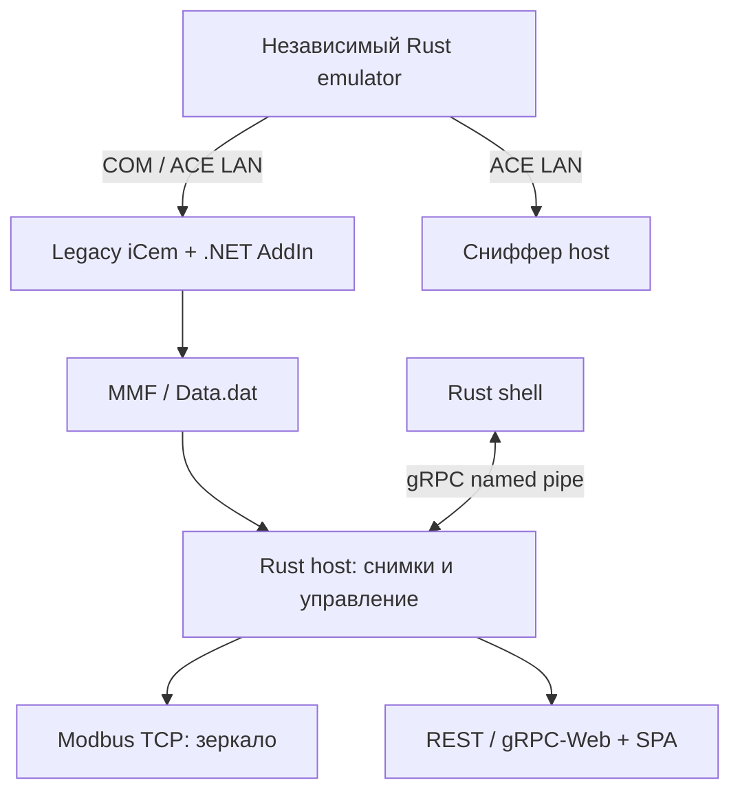

# Архитектура миграции

Статус: целевая архитектура; выполнен M0-каркас и первый Modbus-инкремент (см. IMPLEMENTATION_STATUS.ru.md). Контракты фактической базы перечислены
в API_SPEC.ru.md. Требование — функциональная идентичность с меньшим собственным
дистрибутивом, без .NET 10/WinAppSDK в перенесённой части.

## Граница миграции

`Burservis.iCem.DataMonitor` остаётся управляемой net48 DLL внутри iCem.exe.
Её зависимости, типы, способы загрузки и логика формирования шины сохраняются.
Rust не загружается в legacy-процесс через P/Invoke: уже существующая MMF — граница.
Значит CLR .NET Framework 4.8 остаётся предпосылкой legacy iCem, но не Rust-host.
DLL-исходники находятся в `../Burservis.iCem.DataMonitor/` без изменений.

Host, клиентская оболочка и эмулятор переписываются на Rust. Фронтенд остаётся HTML/CSS/JS:
язык UI-ресурсов не делает сервер .NET-приложением. Существующая SPA сначала сохраняется
побайтово; перенос серверной части не должен одновременно менять графики и форматы.

Сниффер не пишет в MMF. Host не запускает, не надзирает и не закрывает эмулятор.
Завершение host закрывает только собственную оболочку. Эмулятор имеет отдельные UI,
CLI, mutex и control pipe. Сохранение этих границ важнее объединения всех EXE в один.

## Владение и зависимости

| Модуль | Владеет | Не владеет | Следующий случай того же класса |
|---|---|---|---|
| icem-bus | Формат v5, проверенный owned snapshot | MMF handles, Windows, сетевые сессии | Новая layout version — отдельный decoder + explicit dispatch; v5 неизменен |
| icem-core | Прикладные команды и порты снимков | Регистровые алгоритмы ACE, сеть, UI | Новый SnapshotSource — реализация порта и композиция |
| icem-config | Значения config.ini/XML, валидация, active path | Состояние слушателя | Новый ключ — schema + validation + persistence + completeness gate |
| icem-protocols | Modbus/ACE/FLECS codecs, iCem catalogs | Сокеты, драйверы, жизненный цикл host | Новый кодек — собственный модуль, таблицы и fixture |
| icem-emulation | DFB-состояние, overrides, presets, units | Host-процесс, station bus | Новый DFB — блок и включение в network factory |
| icem-platform-windows | RAII OS handles, синхронная MMF-копия, events, трей | Прикладное решение команды | Новый native adapter — реализация одного конкретного порта |
| icem-transport | Protocol adapters, protobuf/JSON projection | Второе состояние измерений | Новый транспорт — адаптер над теми же application services |
| apps | Composition root, argv и ошибки запуска | Дублированные правила шины/команд | Регистрация конкретного adapter |

Каркас содержит только подтверждённые порты. Нет динамического загрузчика плагинов:
несколько модулей одного workspace не обязаны иметь отдельную DLL или независимый runtime.
Внутренний Rust API не является стабильным бинарным ABI. Внешняя стабильность — proto,
HTTP, MMF, Modbus и именованные каналы/объекты Windows.

## Инварианты до кодирования M0

Class: валидные образы Bus v5; усечённый образ или layout v4 вне класса.
Inv: точная длина 64+2N, header LE/body BE и CDAB сохраняются; проверки `icem-bus` + fixtures.
N+1: следующий layout добавляется отдельным decoder и проверенным выбором; текущий v5 не расширяется флагами.

Class: запросы диапазона Modbus FC03/04/06/16; произвольная команда ACE вне класса.
Inv: количество и границы проверяются до доступа, сложение расширено до u32;
проверки `icem-protocols/src/modbus.rs`. N+1: новый FC — exhaustive match + wire fixture.

Class: источники команды host (трей, Windows events); emulator-команды вне класса.
Inv: одна политика lifecycle независимо от источника, проверка переходов планируется M3.
N+1: новый источник вызывает HostCommands, не копирует shutdown/restart.

## Потоки исполнения

Native UI message loop обслуживает только окна/трей; network runtime выполняет I/O.
Windows mutex имеет thread ownership: захват, копирование и освобождение происходят
на одном worker thread без await внутри guard. После копирования mutex освобождается,
затем парсится owned buffer. Никаких долгоживущих Rust ссылок в внешнюю MMF.
Сетевые запросы, публикация Modbus, история и UI читают снимки; отдельное writable
Modbus-зеркало необходимо по контракту FC06/16, это не второй источник bus-данных.

Таймеры: mirror 200–500 ms; ring 1 Hz; metrics минимум 200 ms; liveness 5 s.
При медленном клиенте отдельный ограниченный queue и explicit lag/disconnect policy;
целые сообщения/deltas нельзя терять незаметно. Размеры очередей утверждаются в M1
после baseline; в M0 нельзя выдавать произвольный лимит за исходное поведение.

## Выбор UI и библиотек

Решение пользователя 2026-10-16: **GPUI** для desktop shell/emulator, с полным
воспроизведением исходных custom controls, включая Apple-style appearance. GPUI не
подключается к web host и не увеличивает его dependencies. До desktop реализации
обязательны точный pin GPUI, Windows/DPI/focus/IME/accessibility и size spike; UI
не получает PASS по факту выбора библиотеки. Web SPA сохраняется HTML/CSS/JS.
Как показывать SPA в desktop-вкладке «Панель» (GPUI-native rendering или совместимая
web-view integration) — отдельный design gate: нельзя молча выбросить эту вкладку.
Tray выполняется после emulator; общий lifecycle не дублируется в UI handlers.

Сеть: реализован development backend Axum + Tokio + tonic/prost + tonic-web.
Нужен именно HTTP/2 gRPC поверх именованного pipe, а не самодельный JSON вместо gRPC.
Зависимости web backend подключены и фиксируются Cargo.lock; [границы](WEB_STATUS.ru.md).
WebView2 и Npcap/com0com учитываются отдельно при измерении установки.
