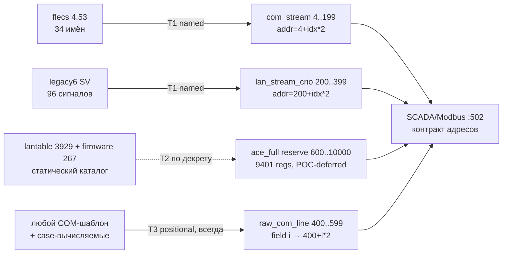

# FUTURE_full_coverage_spec — 100% именованного покрытия COM/LAN (проект, реализация НЕ начата)

> **STATUS: FUTURE / PROMOTION-CANDIDATE (§15.2).** Этот документ — проектная спецификация.
> Реализация — **ТОЛЬКО по явному указу пользователя** (варианты триггеров — раздел 7).
> Машиночитаемый источник фактов: `specs/iCemAddIn/Э8_design_variableid.yaml` (дизайн v2, атаки A1–A11).
> Настоящий md — человекочитаемая длинная форма (декритом пользователя 2026-08-18 допущен md для этого артефакта).
> Действующий контракт: bus v5/v5.1 (10001 регистр, 20066 B), единый именованный источник + универсальная raw-зона — см. `specs/iCemAddIn/Э0_mission.yaml` (decisions).
> Историческая до-переименовочная копия этого документа (stale-имена DataTap.AddIn / gen_datatap_map.ps1 / DataTapAddressMap.cs) УДАЛЕНА по решению владельца 2026-08-21 (была: `specs/_archive/devlog/FUTURE_full_coverage_spec.md`). Канон — только этот файл.

---

## 1. Цель и область

| # | Факт |
|---|---|
| 1.1 | Цель проекта: FUTURE полное именованное покрытие статических источников COM/LAN без правки vendor-кода и без регрессии SCADA-контракта шины |
| 1.2 | РЕАЛЬНОЕ определение «100%»: **100% статического master-universe по декретированным tier**; динамические case-переменные НИКОГДА не покрываются enum (структурно невозможно — атака A4) |
| 1.3 | Динамическая лента: `raw_com_line` 400..599 (float32 CDAB, поле i → 400+i*2, ≤100 полей, template-agnostic) — единственный всегда-свежий канал (v5.1 CHANGE 2) |
| 1.4 | Tier T1 — observed-wire: 34 com (flecs) + 96 lan (legacy6 SV) + 73 vendor-алиаса — **СДЕЛАНО сегодня**, это неизменяемое ядро |
| 1.5 | Tier T2 — static catalog: Cementer-scope (846 значений) или merged catalog (4196 значений) — только по декрету зоны (раздел 3) |
| 1.6 | Tier T3 — dynamic: не именуется никогда; raw-зона + петля MISS (раздел 2.6) |
| 1.7 | Границы: реализация затрагивает ТОЛЬКО `C:\Users\HALLIBURTON\iCemPOC\Burservis.iCem.DataMonitor` (+ specs); server-dotnet — только как ripples (docs) |



---

## 2. Дизайн v2 — трёхслойная архитектура

### 2.1 Слой 1 — identity и enum (VariableId)

| # | Факт |
|---|---|
| 2.1.1 | identity = **(authority, normalizedAsciiName)**; НИКОГДА DB ID (postdeploy.sql/reseed — unverifiable из репо, атаки A1/A2) |
| 2.1.2 | authority ∈ {`ComFlecs`, `LanLantable`, `LanFirmware`}; enum на каждую authority: `ComNamed`, `LanNamed`, `FirmwareNamed` |
| 2.1.3 | normalizedAsciiName = правило `NameNormalizer` (alnum, lower); член enum несёт identity, **ordinal не несёт семантики** (атака A10) |
| 2.1.4 | Источники (уже существуют): registry-семья `flecs` (34, mb4) для ComNamed; `lantable_registry.json` (3929 уникальных, 194 SV) + `firmware_registry.json` (267, 14 SV) для LanNamed/FirmwareNamed; registry уже содержит 3463 lan-записи idx 0..3462 (атака A11 — нового сбора данных нет) |
| 2.1.5 | Генерация: расширение `gen_datamonitor_map.ps1` — генератор остаётся единственным источником правды; `DataMonitorAddressMap.cs` руками не правится |

### 2.2 Слой 2 — alias sidecar (имя → VariableId)

| # | Факт |
|---|---|
| 2.2.1 | Ключ sidecar: **(family, normalizedObservedName) → canonical identity**; формат — CSV, как `lan_vendor_aliases.csv` |
| 2.2.2 | Линт `Assert-Resolves`: каждая строка sidecar обязана резолвиться ровно в ОДНУ (family, canonical) текущего master — иначе генерация **FAILS** (нет «тихих мёртвых» алиасов; атака A9) |
| 2.2.3 | Линт коллизий per-authority: два identity с одним normalized-именем в одной authority = generation-time REPORT (прецедент `BuildNormMap`); cross-family совпадение ЛЕГАЛЬНО (source affinity) — прецедент `Unit Num`: com=6(6) ∧ lan=254(0xFE) |
| 2.2.4 | Нормализация хранит только ASCII-alnum ⇒ локализация/кодировка дисплейных имён не ломает ключи; display-имя живёт в sidecar, identity — canonical |

### 2.3 Слой 3 — закрытый адресный закон (address book)

| # | Факт |
|---|---|
| 2.3.1 | Адресный закон = **сгенерированная закрытая таблица (VariableId → addr)**, НЕ арифметика ordinal (атака A10) |
| 2.3.2 | Book **append-only + tombstone**: публикация адреса необратима; перегенерация НИКОГДА не перенумеровывает опубликованный адрес |
| 2.3.3 | Seed (book v1, verbatim): ComMap 34 + LanMap 96 + 73 vendor-алиаса (текущее состояние); `200+idx*2` остаётся законом ТОЛЬКО для T1 curated-набора; расширенные наборы получают адреса из book |
| 2.3.4 | Все адреса ∈ декретированным зонам (contract test) |

### 2.4 Зоны и ownership (куда физически пишет book)

| # | Факт |
|---|---|
| 2.4.1 | T1: com_stream 0x4..0xC7(4..199), lan_stream_crio 0xC8..0x18F(200..399) — AddIn, как сегодня |
| 2.4.2 | T2 (будущее): новая AddIn-зона ИЗ резерва ace_full 0x258..0x2710(600..10000) — см. декреты раздела 3 |
| 2.4.3 | `AddInMaxReg` (сегодня 599=0x257) пересматривается ТОЛЬКО вместе с декретом зоны; POC sniffer перескоповывается на остаток резерва |
| 2.4.4 | raw_com_line 0x190..0x257(400..599) — вне book (позиционная зона, владелец AddIn) |

### 2.5 Ключевые контракт-тесты (пины дизайна при реализации)

| # | Тест | Пин |
|---|---|---|
| 2.5.1 | `book(vNext) ⊇ book(vCurrent) ∧ ¬∃ moved entry` | append-only, адрес-стабильность (атака A5) |
| 2.5.2 | renaming registry-записи не двигает её адрес | identity = имя, адрес закреплён |
| 2.5.3 | каждая строка sidecar резолвится (Assert-Resolves) | нет мёртвых алиасов (A9) |
| 2.5.4 | ∀ VariableId ∈ book ⇒ ∃ адрес в декретированной зоне | полнота и зональность (A3) |
| 2.5.5 | вставка нового члена enum не меняет существующие адреса | ordinal-agnostic (A10) |
| 2.5.6 | per-authority collision report: 0 скрытых дропов | (A7) |

### 2.6 Петля обратной связи по именам (alias feedback pipeline)

```mermaid
flowchart LR
  N[неизвестное имя<br/>в полле/линии] --> R[raw_com_line<br/>400..599 позиционно]
  N --> L[SKIPTOP MISS<br/>TapOut.log]
  R --> SCADA[SCADA видит сырьё]
  L --> REV[ops-обзор:<br/>имя → canonical identity]
  REV --> SIDE[строка sidecar<br/>(family, displayName)]
  SIDE --> LINT[Assert-Resolves lint]
  LINT --> REGEN[генерация book vNext]
  REGEN --> DEPLOY[deploy + iCem restart]
  DEPLOY --> NAMED[именованное покрытие]
```

| # | Факт |
|---|---|
| 2.6.1 | Лаг петли = цикл deploy; именованное покрытие = best-effort, raw-зона = гарантия свежести (атака A8) |
| 2.6.2 | Процедура живёт в ops-runbook (не в коде); кандидаты ревьюятся человеком |

---

## 3. Ёмкость и декреты (capacity chapter)

| # | Расчёт | Источник |
|---|---|---|
| 3.1 | com 100%: 247 vars × 2 = **494 regs > 196 regs** ком-зоны (98 пар) ⇒ **com-100% в 4..199 физически невозможно**; расширение ком-зоны = отдельный декрет, НЕ часть этого проекта | ammo + Э8 A3 |
| 3.2 | lan merged catalog: 4196 значений = **8392 regs** float-pairs; помещается ТОЛЬКО в резерв ace_full **0x258..0x2710(600..10000) = 9401 regs** | Э2b rows 45–50 |
| 3.3 | lan wire-reality (legacy6+firmware): 363 значения = **726 regs** | Э2b row 45 |
| 3.4 | Cementer-scope (34 SV + 14 firmware): 846 значений = **1692 regs** | Э2b row 46 |
| 3.5 | Резерв сегодня **POC-deferred**: никто не пишет 600+, `AddInMaxReg=599`, sniffer-ownership | Э2b rows 42/50 |
| 3.6 | ⇒ **«100%» живёт ТОЛЬКО в резерве**; пока декрета нет — покрытие остаётся T1 + raw lane | вердикт атаки A3 |

**Требуемые декреты для T2 (каждый — явное решение пользователя):**

| # | Декрет | Содержание |
|---|---|---|
| 3.7 | D-T2a | Новая AddIn-зона из резерва: диапазон `600..600+2N-1` под float-pairs named-lan |
| 3.8 | D-T2b | Пересмотр `AddInMaxReg` (599 → верх новой зоны) |
| 3.9 | D-T2c | Перескоп POC sniffer: остаток резерва остаётся его |
| 3.10 | D-T2d | Выбор объёма: wire-reality (726 regs) / Cementer (1692 regs) / merged (8392 regs) |

---

## 4. Миграционный путь (пошагово, каждый шаг аддитивен — rule_n_plus_1)

| # | Шаг | Изменение | Rollback |
|---|---|---|---|
| 4.1 | M1: generator-расширение | `gen_datamonitor_map.ps1` начинает эмитить book v1 = verbatim текущие ComMap 34 + LanMap 96 + 73 алиаса; адреса тождественны | book v1 ≡ текущие словари ⇒ нулевой риск; откат = старый генератор |
| 4.2 | M2: lookup-тонкий слой | `TryGetComAddress/TryGetLanAddress` читают из book (словари остаются, засев одинаковый) | поведение тождественно; тесты 321/321 остаются зелёными |
| 4.3 | M3: contract tests 2.5 | добавляются тесты append-only/resolves/zone-bounds ДО первой прибавки | тесты не меняют поведение |
| 4.4 | M4: первый аппенд | по декрету T2d добавляются новые (family, имя, адрес) строки в book; адреса — из новой зоны | откат = откат декрета, удаление строк; опубликованные адреса НЕ переносятся |
| 4.5 | M5: sidecar-петля в проде | ops-runbook + lint в генераторе | без эффекта на существующие алиасы |
| 4.6 | Invariant на каждом шаге: существующие адреса бит-в-бит стабильны; iCem restart только в момент deploy (INC-03 не применим — резерв не открывается до декрета) | | |

---

## 5. Отвергнутые альтернативы (kill-reasons)

| # | Альтернатива | Kill-reason |
|---|---|---|
| 5.1 | Плоский единый enum над vendor DB ID (исходный 3-слойный набросок) | ID-диапазоны authorities пересекаются; reseed нестабилен (A1/A2) |
| 5.2 | Адрес = арифметика ordinal enum | любая вставка перенумеровывает опубликованный SCADA-контракт (A10) |
| 5.3 | Класс на каждую переменную (генерация типов) | кодогенерация без выигрыша над book-таблицей; нарушает «минимальная поверхность кода» декрет |
| 5.4 | Буквальное «100%» включая case-вычисляемые | структурно невозможно: их нет ни в одном master-списке (A4, live SKIPTOP MISS) |
| 5.5 | 100% именованного покрытия ВНУТРИ текущих зон (без декрета резерва) | ёмкость: 494>196 (com), 8392>9401-недоступно (lan) (A3) |

---

## 6. Falsifiers (приёмочные критерии реализации)

| # | Falsifier | Формулировка |
|---|---|---|
| 6.1 | F1 | book(vNext) ⊇ book(vCurrent) ∧ ¬∃ перемещённый адрес (contract test) |
| 6.2 | F2 | ∀ строка sidecar резолвится; нерезолв = FAIL генерации |
| 6.3 | F3 | ∀ VariableId ∈ book ⇒ ∃ адрес ∈ декретированным зонам; вне зон = FAIL |
| 6.4 | F4 | ∃ name в SKIPTOP MISS, для которого нет строки sidecar ⇒ петля запускается (не код-дефект, а процесс) |
| 6.5 | F5 | Переименование registry-записи сохраняет адрес (identity pinned) |

---

## 7. Триггеры и оценка работ

| # | Триггер (любой ⇒ можно начинать, только по указу) | Оценка |
|---|---|---|
| 7.1 | Декрет D-T2 (зона из резерва + AddInMaxReg + перескоп sniffer + объём T2d) | M1–M4: ~1–2 дня |
| 7.2 | Потребность SCADA-потребителя в конкретных именах вне T1 | M4 по точечному аппенду: ~часы |
| 7.3 | Смена шаблона с именованным требованием (не raw) | M5 + аппенд: ~часы |
| 7.4 | Без триггера: НИЧЕГО не реализуется — дизайн закреплён, реализация дешева (Э8) | — |

---

## 8. Связи и источники

| # | Артефакт | Роль |
|---|---|---|
| 8.1 | `specs/iCemAddIn/Э8_design_variableid.yaml` | машиночитаемый дизайн v2 (атаки A1–A11, verdicts) |
| 8.2 | `specs/dotnet-server/Э2b_ace_full_measurement.csv` | ёмкостная математика (rows 42–50) |
| 8.3 | `specs/iCemEmule/Э2c_lan_zone_classification.csv` | прецедент alias-harvest (73 имени) |
| 8.4 | `specs/iCemAddIn/Э0_mission.yaml` decisions | single-named-source + raw-lane декреты + §15.2 |
| 8.5 | `templates/variable_registry.json` + `iCemEmule/templates/lantable_registry.json` + `iCemEmule/templates/firmware_registry.json` | master-списки слоя 1 |
